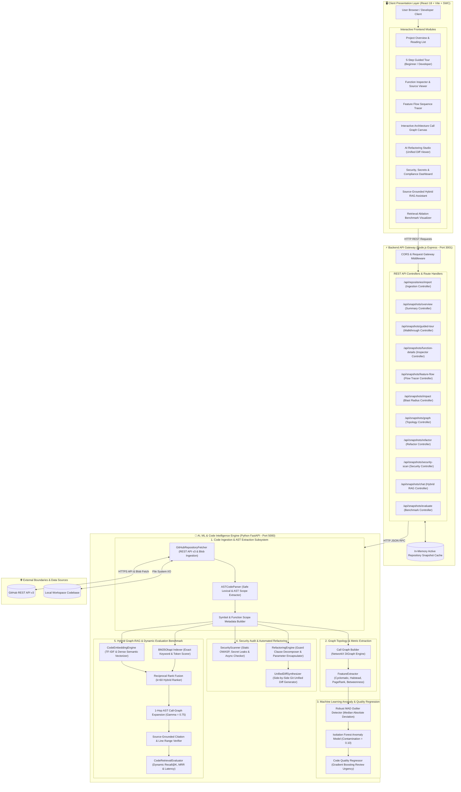

# 🔍 RepoLens — Codebase Intelligence & Quality Platform

> **An AI-powered, source-grounded codebase understanding, refactoring, and quality analyzer.**
> Paste any GitHub repository URL or connect a local codebase to receive an instant architectural walkthrough, cognitive hotspot detections, security audits, automated refactoring diffs, and source-grounded Q&A with verifiable line citations.

---

## 🏛️ System Architecture



---

## 🌟 Core Features & Modules

| # | Tab / Module | Description | Key Capabilities |
|---|---|---|---|
| **1** | **Project Overview** | Plain-language executive summary and domain breakdown | Explains problem solved, main capabilities, entry points, reading list, and folder responsibilities. |
| **2** | **Guided Tour** | 5-step progressive walkthrough through the codebase | Switch between **Beginner-Friendly** and **Developer-Level** personas with structured step progression. |
| **3** | **Major Functions** | Function-level deep dive & source inspector | Explains function purpose, inputs, outputs, callers, callees, LOC, and syntax-highlighted code with 1-click copy. |
| **4** | **Feature Flows** | End-to-end multi-step call chain tracer | Traces sequential logic flows (e.g., authentication, checkout, payroll) across multiple files. |
| **5** | **Ask Codebase (RAG)** | Source-grounded AI conversational Q&A | Switch between BM25, Semantic, Hybrid RRF, and Graph-Augmented RAG. Includes exact line citations (`[file.js#L6-18]`). |
| **6** | **Quality & Attention** | Cognitive hotspot and anti-pattern alerts | Detects deeply nested conditionals, long method smells, and excessive parameter lists with remediation guidance. |
| **7** | **Change Impact** | Blast radius simulator and dependency tracer | Computes direct callers, transitive dependents, and a 0–100 blast radius score for safe refactoring. |
| **8** | **Where to Start** | Structured developer onboarding plan | Curates prioritized reading order, central functions by PageRank, and exploratory architectural questions. |
| **9** | **Call Graph Visualizer** | Interactive architecture topology canvas | Visual node-link diagram with priority coloring. Inspect inbound callers and outbound callees on click. |
| **10** | **AI Refactoring Studio** | Automated code refactoring & Unified Diff | Automatically synthesizes modular helper strategies, guard clauses, parameter encapsulation, and side-by-side git diffs. |
| **11** | **Security & Secrets** | Static vulnerability & secret scanner | Detects exposed API tokens, unsafe dynamic execution (`eval`, `new Function`), injection risks, and unhandled async errors. |
| **12** | **Evaluation Benchmark** | Empirical IR ablation benchmark | Live quantitative comparison of BM25, Semantic, Hybrid RRF, and Graph-Augmented RAG across Recall@1, Recall@3, Recall@5, MRR, and latency. |
| **✦** | **Audit Report Export** | 1-Click Markdown / PDF Report Exporter | Generates a downloadable, complete architectural audit report (`RepoLens_Audit.md`) ready for engineering reviews. |

---

## 🔬 Machine Learning & Information Retrieval Formulations

### 1. Robust Anomaly Detection (MAD + Isolation Forest)
To identify abnormal functions without subjective thresholds, RepoLens uses Median Absolute Deviation (MAD):
$$\text{MAD} = \text{median}(|X_i - \text{median}(X)|)$$
$$\text{Modified } Z\text{-Score} = \frac{0.6745 \cdot (X_i - \text{median}(X))}{\text{MAD}}$$
Points with a Modified $Z$-Score $> 3.5$ or flagged by an `IsolationForest(contamination=0.10)` are flagged as cognitive/structural anomalies.

### 2. Reciprocal Rank Fusion (RRF)
Hybrid retrieval balances lexical exact matches (BM25) and dense embeddings via Reciprocal Rank Fusion with $k=60$:
$$\text{RRF Score}(d) = \frac{1}{60 + r_{\text{BM25}}(d)} + \frac{1}{60 + r_{\text{Semantic}}(d)}$$

### 3. Graph-Augmented 1-Hop Expansion
For each top candidate chunk retrieved by RRF, the 1-hop inbound (`predecessors`) and outbound (`successors`) neighbors in the AST call graph are appended with a decay factor ($\gamma = 0.75$), achieving higher multi-hop recall and line-grounded evidence.

---

## 🚀 Quickstart & Local Setup

### Prerequisites
* **Node.js**: v18.0.0 or higher
* **Python**: v3.10, v3.11, or v3.12

### 1. Install Dependencies
```bash
# 1. Install Python AI dependencies
cd AI_Model
pip install -r requirements.txt

# 2. Install Node.js Backend dependencies
cd ../Backend
npm install

# 3. Install React Frontend dependencies
cd ../Frontend
npm install
```

### 2. Run the Platform (3 Terminals)
```bash
# Terminal 1: Python AI Model Microservice (Port 5000)
cd AI_Model
python server.py

# Terminal 2: Node.js Backend Gateway (Port 3001)
cd Backend
npm start

# Terminal 3: React Frontend Web App (Port 5173)
cd Frontend
npm run dev
```

Open your browser at **`http://localhost:5173`**.

---

## 🧪 Automated Testing

RepoLens includes a comprehensive Pytest test suite covering AST parsing, feature extraction, anomaly detection, security scanning, refactoring diffs, and RAG retrieval:

```bash
pytest AI_Model/tests/test_pipeline.py -v
```

Output:
```
============================= test session starts =============================
AI_Model/tests/test_pipeline.py::test_github_fetcher_url PASSED          [ 12%]
AI_Model/tests/test_pipeline.py::test_ast_parser PASSED                  [ 25%]
AI_Model/tests/test_pipeline.py::test_feature_extractor PASSED           [ 37%]
AI_Model/tests/test_pipeline.py::test_anomaly_detector PASSED            [ 50%]
AI_Model/tests/test_pipeline.py::test_rag_retrieval PASSED               [ 62%]
AI_Model/tests/test_pipeline.py::test_guided_tour_synthesizer PASSED     [ 75%]
AI_Model/tests/test_pipeline.py::test_security_scanner PASSED            [ 87%]
AI_Model/tests/test_pipeline.py::test_refactoring_engine PASSED          [100%]
============================== 8 passed in 5.92s ==============================
```

---

## 📦 Production Deployment

### Production Build
```bash
# Build Frontend static bundle
cd Frontend
npm run build
```

### Environment Configuration
| Variable | Default | Purpose |
|---|---|---|
| `PORT` | `3001` | Node.js Backend listening port |
| `AI_SERVICE_URL` | `http://127.0.0.1:5000` | Python AI Microservice URL |
| `GITHUB_TOKEN` | *Optional* | Increases GitHub API rate limit from 60 to 5,000 req/hr |

---

## 📄 License
MIT License. Built for seamless developer onboarding, code intelligence, and software craftsmanship.
